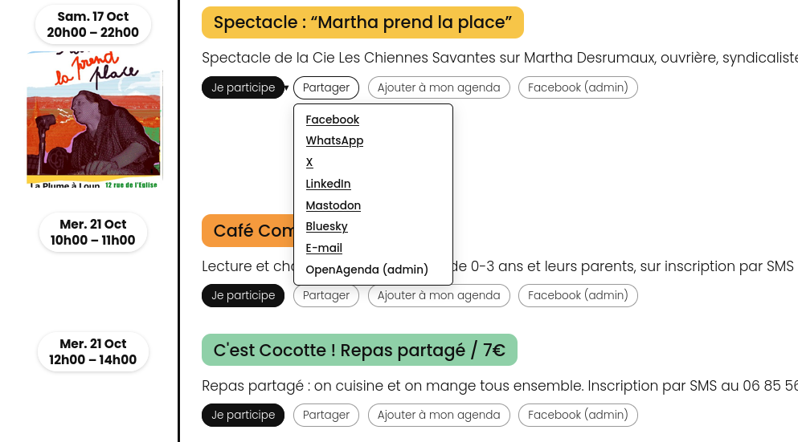

# Extension WordPress : événements de tiers-lieux.org

Affiche sur un site WordPress les événements d'un tiers-lieu saisis sur [tiers-lieux.org](https://www.tiers-lieux.org), avec ajout à l'agenda, partage sur les réseaux, « Je participe » et « Ajouter un événement ».

## Installation

1. Compresser le dossier `tiers-lieux-events/` en zip.
2. Dans WordPress : Extensions → Ajouter → Téléverser, puis activer.
3. Réglages → **Événements Tiers-Lieux** : choisir son tiers-lieu.
4. Placer le code court `[tiers_lieux_events]` dans un bloc « Code court » d'une page.

Toutes les options (code court, agenda, partage, OpenAgenda…) sont décrites dans le [README de l'extension](tiers-lieux-events/README.md).
